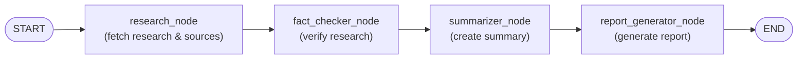

# Multi-Agent Research Assistant (MARA)

Multi-Agent Research Assistant is a lightweight research orchestration project built with FastAPI, Streamlit, and LangGraph. It uses a state-based workflow to gather research, verify facts, summarize findings, and generate a final report for a user-provided query.

## Features

- FastAPI backend powering a multi-step research workflow
- Streamlit frontend for interactive research input and output
- LangGraph-based pipeline with research, fact-checking, summarization, and report generation
- Simple HTTP API for programmatic use

## Repository structure

- `app/` — core multi-agent pipeline, API routes, models, and workflow graph
- `frontend/` — Streamlit UI and frontend API client
- `pyproject.toml` — Python project metadata and dependencies
- `README.md` — this documentation

## Requirements

- Python 3.12 or newer
- `pip` or another Python package manager

## Installation

From the repository root:

```bash
python -m pip install --upgrade pip
python -m pip install -r requirements.txt
```

> If you do not have a `requirements.txt`, install directly from `pyproject.toml` using your package manager.

Alternatively, install dependencies directly:

```bash
python -m pip install fastapi httpx langchain langchain-core langchain-google-genai langchain-tavily langgraph pydantic python-dotenv requests streamlit uvicorn
```

## Running the application

### 1. Start the API backend

Run the FastAPI backend from the project root:

```bash
python -m uvicorn app.api.app:app --reload --host 127.0.0.1 --port 8000
```

The backend will be available at `http://127.0.0.1:8000`.

### 2. Start the Streamlit frontend

Open a new terminal and run:

```bash
streamlit run frontend/app.py
```

The Streamlit app will typically open automatically in your browser. If not, visit the URL shown by Streamlit.

## Using the app

1. Enter a research topic in the Streamlit text input.
2. Click the `Research` button.
3. View the generated report, summary, and sources.

## API endpoint

The backend exposes a single POST endpoint:

- `POST /research`

Request body:

```json
{
  "query": "Your research topic"
}
```

Response body:

```json
{
  "query": "Your research topic",
  "summary": "...",
  "report": "...",
  "sources": [
    {
      "title": "...",
      "url": "..."
    }
  ]
}
```

## LangGraph workflow

The application uses LangGraph to define a directed state graph that processes research input through four nodes.



- `research_node`: performs the initial research pass and returns raw research text plus sources.
- `fact_checker_node`: verifies the research content and stores verified results.
- `summarizer_node`: summarizes the verified research.
- `report_generator_node`: builds the final report using the summary and source list.

## Notes

- The frontend client is configured to send requests to `http://127.0.0.1:8000` by default.
- The app uses a custom LangGraph workflow defined in `app/graph/workflow.py`.
- Customize the assistant behavior by editing `app/agents/` and `app/prompts/`.
